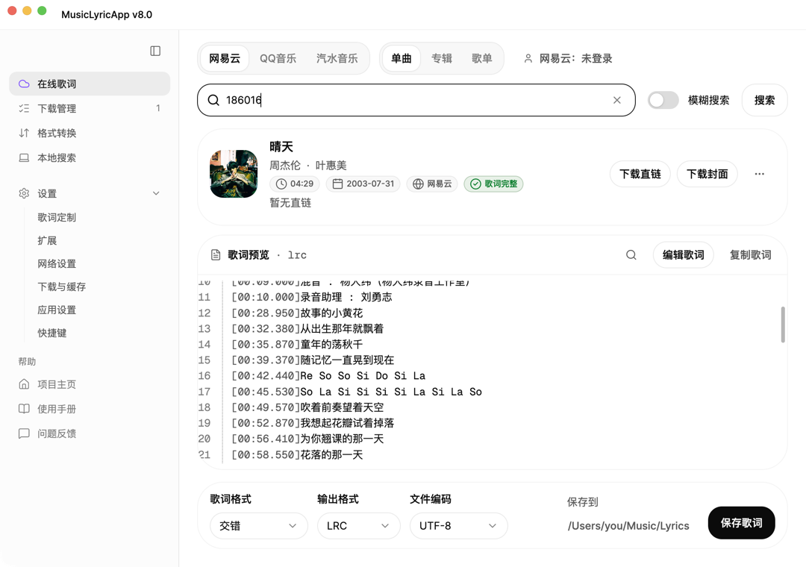
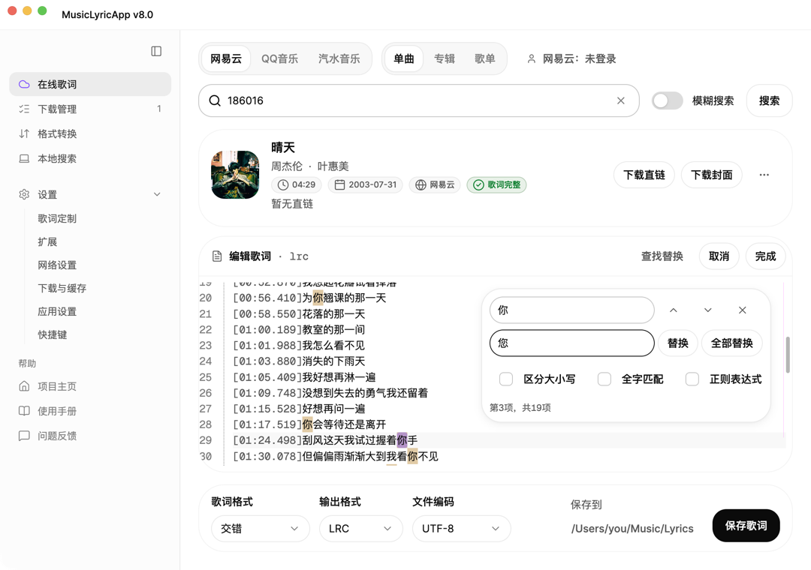
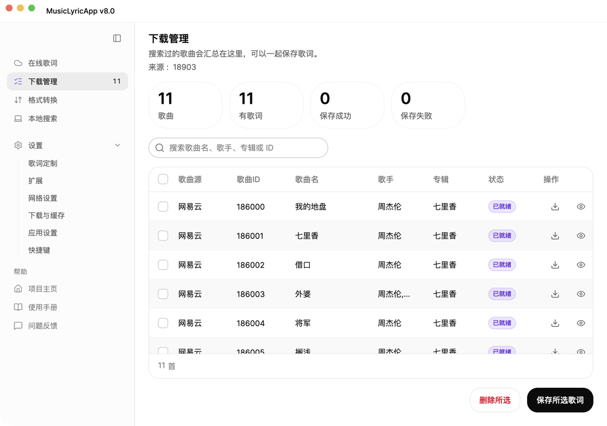
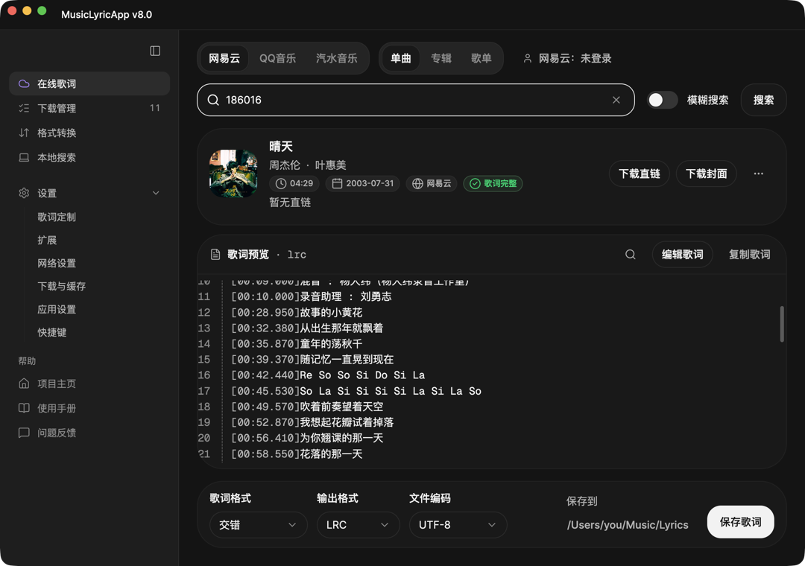

# 163MusicLyrics

获取网易云音乐、QQ 音乐、汽水音乐的歌词，支持预览、编辑、翻译、格式转换和批量保存。支持 Windows、macOS 和 Linux。

Get lyrics from NetEase Cloud Music, QQ Music and Soda Music, then preview, edit, translate, convert and save them in bulk. Runs on Windows, macOS and Linux.

  
  

  
  

### 使用文档 How To Use

[👉 8.0 使用文档 8.0 User Guide](https://github.com/jitwxs/163MusicLyrics/wiki/8.0-Guide)

### 功能 Features

**获取歌词 Getting lyrics**

- [x] 支持网易云音乐、QQ 音乐、汽水音乐三个平台 Three sources: NetEase Cloud Music, QQ Music and Soda Music
- [x] 支持单曲、专辑、歌单三种类型，可用 ID 或链接精确搜索，粘贴链接自动识别平台 Song, album and playlist; search by ID or link, and a pasted link picks its source
- [x] 支持关键字模糊搜索，结果在页面内选择 Keyword search with the results chosen in place
- [x] 支持批量搜索（逗号分隔）与文件夹扫描 Batch search (comma separated) and folder scan
- [x] 本地搜索：扫描本地音乐文件，按标签匹配歌曲并在音乐旁保存歌词 Local search: scan your music files, match them by their tags and save lyrics beside them

**处理歌词 Working with lyrics**

- [x] 歌词预览带行号与时间戳高亮，可直接编辑，支持查找替换（区分大小写、全字匹配、正则）与撤销 Preview with line numbers; edit in place with find and replace (case, whole word, regex) and undo
- [x] 原文、译文、音译、拼音等多种歌词类型，可自由组合与排序，支持交错、独立、合并三种排版 Original, translation, transliteration, pinyin and more, combined and ordered as you like, interleaved, separate or merged
- [x] 支持逐字歌词、简繁转换、自定义 LRC / SRT 时间戳格式 Word-by-word lyrics, Simplified / Traditional conversion, custom LRC and SRT timestamps
- [x] 支持百度翻译、彩云小译自动补全缺失的译文 Baidu Translate and Caiyun Xiaoyi fill in missing translations
- [x] 内置 LRC ↔ SRT 格式转换 Built-in LRC ↔ SRT conversion

**保存与管理 Saving and managing**

- [x] 下载管理：汇总搜索过的歌曲，支持筛选、批量保存，启动时自动恢复最近的缓存 Download manager: every song you searched, with filtering and bulk saving, restored from the cache at startup
- [x] 下载歌曲直链与封面，与歌词使用统一的文件名 Download the audio link and the cover, named like the lyrics
- [x] 自定义文件名模板、编码（UTF-8 / UTF-8 BOM / UTF-32 / Unicode）与同名文件处理 Custom file names, encodings and handling of existing files

**应用 The app**

- [x] 全新界面：侧边栏导航，浅色 / 深色主题 A new single-window interface with a sidebar, light and dark themes
- [x] 简体中文、繁体中文、English 三种界面语言，即时切换 Simplified Chinese, Traditional Chinese and English, switched at once
- [x] 设置中检查 Cookie 登录状态，一键打开平台网页版 Cookie sign-in state checked in settings, with the source's website one click away
- [x] 快捷键与 HTTP 代理设置 Keyboard shortcuts and HTTP proxy settings

### 下载 Downloads

进入 [GitHub Release](https://github.com/jitwxs/163MusicLyrics/releases) 页面下载最新版本，可在 [ChangeLog](https://github.com/jitwxs/163MusicLyrics/wiki/ChangeLog) 查看各版本的变更。

Download the latest version from the [GitHub Release](https://github.com/jitwxs/163MusicLyrics/releases) page; the [ChangeLog](https://github.com/jitwxs/163MusicLyrics/wiki/ChangeLog) lists the changes of each version.

| 系统 System | 文件 File |
|---|---|
| Windows 64 位 | `MusicLyricApp-<版本>-win-x64.zip` |
| Windows 32 位 | `MusicLyricApp-<版本>-win-x86.zip` |
| macOS Apple 芯片 Apple silicon | `MusicLyricApp-<版本>-osx-arm64.tar.gz` |
| macOS Intel | `MusicLyricApp-<版本>-osx-x64.tar.gz` |
| Linux x64 | `MusicLyricApp-<版本>-linux-x64.tar.gz` |

无需安装 .NET，解压即用。macOS 版未经 Apple 公证，首次打开如被拦截，请在 Finder 中右键应用选择「打开」，或在「系统设置 › 隐私与安全性」中允许。

No .NET install is needed; unpack and run. The macOS app is not notarized by Apple: if it is blocked the first time, right-click it in Finder and choose Open, or allow it in System Settings › Privacy & Security.

### 开发 Development

基于 .NET 10、[Avalonia](https://avaloniaui.net/)、[TKCode.Arc](https://github.com/AIDotNet/TKCode.Arc) 和 [AvaloniaEdit](https://github.com/AvaloniaUI/AvaloniaEdit)。编译、测试与打包见 [cross-platform/README.md](./cross-platform/README.md)。

Built with .NET 10, Avalonia, TKCode.Arc and AvaloniaEdit. See [cross-platform/README.md](./cross-platform/README.md) to build, test and package.

### 参与贡献 Contribution

您可访问 [163MusicLyrics Projects](https://github.com/users/jitwxs/projects/1) 了解项目当前阶段的工作计划，如您愿意在其中贡献力量，您可以：

- 将您的想法或发现的 bug 填写在 [Issues](https://github.com/jitwxs/163MusicLyrics/issues) 中，我将不定期进行处理
- Fork 项目，并提交您的 Pull Requests

You can visit [163MusicLyrics Projects](https://github.com/users/jitwxs/projects/1) to see what the project is working on. If you would like to contribute, you can:

- Write feature suggestions or bug reports in [Issues](https://github.com/jitwxs/163MusicLyrics/issues); I will go through them from time to time
- Fork the project and submit your pull requests

### Stargazers over time

### 参考 Reference

本项目部分功能借鉴以下项目 Some features of this project took reference from other projects：

- https://github.com/Binaryify/NeteaseCloudMusicApi
- https://github.com/Rain120/qq-music-api
- https://github.com/jsososo/QQMusicApi
- https://github.com/ElliottSilence/LyricCapture
- https://github.com/xmcp/QRCD
- https://github.com/ivanakcheurov/ntextcat

第三方使用介绍视频 Third party use guide videos

- https://www.bilibili.com/video/BV19R4y197on

### 捐赠 Donate

如果本项目为您带来方便，欢迎 Star 来让更多人发现和使用它。本项目为个人维护项目，不收取任何费用，如果您愿意请作者喝杯咖啡话，欢迎打赏。

If this project brings you convenience, you're welcome to star it to let more people discover and use it. This project is
maintained personally, all features are free. If you would like to treat the creator with a bottle of coke, you're welcome to donate.

如您选择打赏，记得备注您的昵称，我将不定期为您登记到  [DONATE.md](./DONATE.md) 页面中。

If you choose to donate, remember to note your nickname, I will register it to  [DONATE.md](./DONATE.md) at free time.

    
    

最后，感谢 JetBrains 为开源项目提供免费的 IDE 支持。

Lastly, thanks to JetBrains for sponsoring the IDE for open-sources project.

